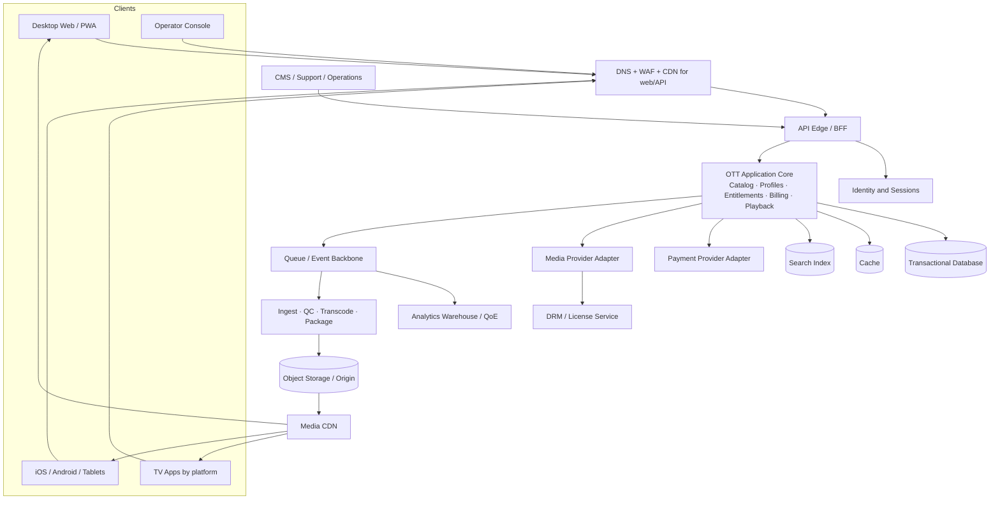
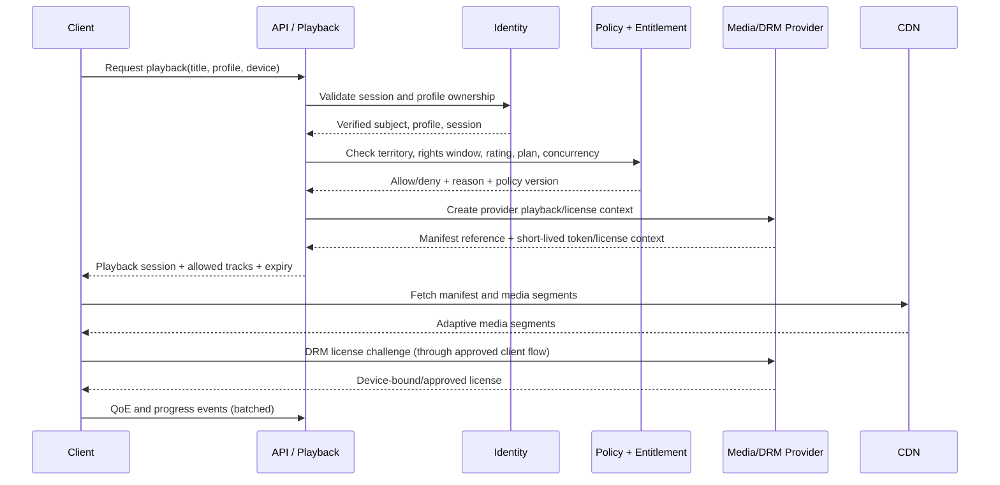

# TongdonTV OTT — Comprehensive System Design Plan

**Status:** Architecture proposal for discovery and implementation planning  
**Date:** 6 November 2026  
**Related plan:** [OTT_PROJECT_PLAN.md](OTT_PROJECT_PLAN.md)  
**Decision posture:** Cloud and vendor neutral. AWS examples below are illustrative reference mappings, not procurement decisions. This design assumes one consumer service, rights-cleared VOD first, subscription-first monetization, and selective TV platform rollout. Live, ads, rentals, offline downloads, multi-tenant white-label, and creator payouts remain separately gated capabilities.

## 1. Design objectives

1. Deliver the correct title to an entitled viewer, in the allowed territory and window, on a supported device.
2. Make playback reliable and measurable from asset intake through the viewer’s first frame and entire session.
3. Let content and support operations work safely without engineering intervention for routine tasks.
4. Protect accounts, personal data, payments, and content rights with auditable controls.
5. Scale delivery economically through managed encoding, object storage, and CDN before building custom media infrastructure.
6. Support desktop web, iOS/iPadOS, Android phones/tablets, and staged TV apps without forcing one UI implementation onto every platform.
7. Preserve a path to higher scale through well-defined domain boundaries, events, and replaceable provider adapters.

### Non-goals for first release

- Building a CDN, DRM system, encoder, payment processor, or recommendation foundation model.
- Splitting every domain into independently deployed microservices before scale or team ownership requires it.
- Launching live sports, third-party IPTV feeds, user comments, offline downloads, multi-brand SaaS, or ad insertion by default.
- Guaranteeing a quality level on every device/browser combination. The service will publish a tested support matrix.

## 2. Architecture overview

The diagram is logical rather than a deployment mandate. The initial application core can be a modular backend deployed as one or a few units. Managed identity, payments, media processing, object storage, CDN, logging, and analytics may be external services. The media data plane (large segment delivery) stays separate from the application control plane (identity, catalog, policy, playback authorization).

### C4-style context and boundaries

| System boundary | Responsibilities | Must not own |
|---|---|---|
| Viewer clients | Discover, select profile, request playback, render player, send QoE and user action events | Authoritative entitlement, payment state, DRM secrets, rights policy |
| Operator console | Draft/edit/approve catalog, rights, artwork, subtitles, plans, reports and support cases | Direct database access or un-audited production writes |
| OTT application core | Product policy, catalog APIs, profiles, entitlements, playback session creation, billing orchestration | Media segment delivery, card data custody, DRM cryptography |
| Identity provider | Authentication factors, credential security, token issuance and session lifecycle | Catalog and content policy |
| Media platform | Upload/ingest, encoding, packaging, origin, CDN integration, DRM/license operations as contracted | Subscriber billing or editorial truth |
| Payment provider | Payment methods, processor transaction and store transaction events | OTT entitlement state without verified webhook/reconciliation |
| Data platform | Product analytics, QoE, reporting, experimentation datasets | Authoritative account, subscription or rights records |

## 3. Deployment and service decomposition

### Initial deployment: modular core

Use a modular monolith or small set of coarse-grained services, owned by explicit domain modules. Candidate modules: Identity Integration, Profiles, Catalog, Rights & Availability, Entitlement, Billing, Playback Session, Notification, Admin, Analytics Event Intake. Enforce module boundaries in code, schema ownership, API interfaces, and event contracts.

Keep these external or independently scalable from day one: identity provider, payment provider, media processing/DRM/CDN, event queue, search index, analytics warehouse. This avoids spending launch time operating a distributed service graph while isolating the inherently vendor-bound and high-bandwidth systems.

### Split a module into a service only when

- There is a clear on-call/team owner and independently meaningful SLO.
- Scaling or failure isolation materially differs from the core application.
- A domain requires independent release cadence or data boundary.
- Measured bottlenecks justify operational complexity.

Likely first candidates at growth: playback authorization, catalog/search read APIs, event collection, media workflow orchestration, and billing webhooks. Do not synchronously call every domain service on the playback hot path; use a compact authorization context and local/short-lived cached policy data with conservative expiry.

### Environment topology

- Separate development, integration/test, staging, and production accounts/subscriptions/projects. Separate media buckets and signing keys by environment.
- Use infrastructure as code, immutable deploy artifacts, managed secrets, automated database migrations with backward compatibility, and staged rollout/rollback.
- Production data is not copied into lower environments. Synthetic catalog/account data and redacted support samples are used for testing.
- Define regions and data residency only after launch market and legal requirements are known. Place API/control services near the primary audience; deliver media from a CDN with regional origin protections.

## 4. Domain model and data ownership

### Core entities

| Entity | Important fields / relationships | Source of truth |
|---|---|---|
| Account | id, normalized email/phone reference, locale, country, status, consent references, created_at | Identity/Account domain |
| Profile | account_id, display name, profile type, maturity level, preferred UI/audio/subtitle languages, PIN state | Profiles domain |
| Device / Session | account_id, app/platform, device family, last_seen, revoked_at, session/token identifiers (hashed where persisted) | Identity/session domain |
| Title | stable ID, type, display metadata, people, genres, language, ratings, external metadata IDs, SEO fields | Catalog domain |
| Season / Episode | parent title, order, episode numbering, release metadata, runtime | Catalog domain |
| Media Asset | title/version, source checksum, technical metadata, ingest status, package/output variants | Media workflow domain |
| Track | asset, kind (audio/caption), language, forced/SDH/audio-description flags, codec/format | Media workflow/catalog |
| Rights Grant | licensor, territory set, start/end, permitted platform/use, contract reference, blackout/hold status | Rights domain; access tightly restricted |
| Availability Rule | title, territory, window, plan/tier, profile maturity, device class, free/premium policy | Rights & Entitlement |
| Plan / Offer | currency, billing interval, market, price reference, trial/promo rules, channel (web/store/partner) | Commerce domain |
| Subscription | account, provider reference, state, period boundaries, cancellation/grace status, reconciliation state | Billing domain |
| Entitlement | subject/profile or account, scope, source, validity window, revocation | Entitlement domain (derived from verified facts) |
| Playback Session | account/profile/title/device, policy decision, issued time, expiry, concurrency lease, provider playback reference | Playback domain |
| Watch Progress | profile/title/episode, position, duration, last updated, completion state | Viewer library domain |
| Collection / Home Section | editorial owner, title membership/order, schedule, published state and version | Editorial domain |
| Audit Event | actor, action, entity, before/after reference, time, trace/request ID | Audit domain, append-only |

### Data design rules

- Use opaque stable IDs; do not put personal data, title names, or internal database IDs in signed media URLs.
- Store time in UTC, preserve source timezone for editorial schedules, and evaluate territory release windows using explicit market rules.
- Keep external provider identifiers in mapping tables; never make vendor IDs the product’s primary IDs.
- Rights grant records and audit history are append-only or versioned. Corrections produce new versions with actor/reason.
- Authoritative transactional records live in a relational database. Search, home rows, recommendations, and analytics are derived projections that can be rebuilt.
- Apply data classification and retention to every field/event. Avoid retaining raw viewing history indefinitely without a documented purpose.
- Use optimistic concurrency/version numbers for editorial updates and idempotency keys for billing, publish, and playback-creation commands.

### Suggested logical storage

- Relational store: account references, catalog, rights, subscriptions, entitlements, editorial content, audit references.
- Cache: short TTL catalog fragments, configuration, and carefully bounded authorization data; never cache mutable policy beyond its explicit validity.
- Search: title, people, transliteration/alternate titles, genres, languages, filters, and availability-aware results. Do not expose unavailable titles where policy says hidden.
- Object storage: original masters, mezzanine assets, artwork, captions, generated renditions, QC evidence; isolated private buckets/containers and lifecycle policy.
- Event/analytics store: append events and QoE measures with pseudonymous identifiers and defined retention.

## 5. Key end-to-end flows

### A. Content ingest to publication

1. Editor creates a draft title or imports metadata; external metadata is a suggestion and must be rights-checked.
2. Rights operator records evidence/reference, territory, window, exclusivity, allowed use/platform, and any blackout.
3. Media operator uploads or requests provider ingest using a resumable, short-lived upload credential. Compute checksum and quarantine the file.
4. Validate file type/size; malware scan; inspect codec, frame rate, duration, audio layout, aspect ratio, slate/black frames, and caption presence. Reject or send to remediation queue on errors.
5. Orchestrator submits an idempotent transcode/package job. Generate an agreed bitrate ladder, audio and caption renditions, HLS and/or DASH packages, thumbnails/previews as rights allow, and DRM encryption if required.
6. Automated QC runs output and playback checks. Human QC approves a sample and metadata/artwork/caption sync.
7. Publish operation validates rights, required tracks, artwork, rating, territory/window, and playback asset. A versioned catalog event updates search and home projections.
8. Scheduled expiry or rights takedown unpublishes availability and invalidates new playback. CDN asset deletion follows rights contract and cache policy; active sessions are revoked where required.

AWS reference mapping for a VOD workflow: private object storage, event trigger/queue, workflow orchestrator, managed transcoding/packaging, output object storage, and CDN. AWS describes a comparable path with MediaConvert and CloudFront; use it as one candidate topology only. Other cloud/media vendors should satisfy the same capability and exit criteria.

### B. Viewer playback authorization and start

The policy decision is server-side and evaluated for every new playback session. The client never decides entitlement. Signed manifests/URLs/cookies and DRM licenses are short-lived and scoped as narrowly as providers support. For session renewal, recheck current account, subscription, territory and rights state. Concurrency is a lease with heartbeat/expiry, not a permanent device counter; allow a support-safe revoke path.

### C. Subscription and payment lifecycle

1. Client asks for an offer catalog scoped to market, platform, currency, and account status.
2. Checkout is created with a server-generated idempotency key. The payment provider/store handles sensitive payment details.
3. Client success screen is provisional. Verified provider webhook or store server notification is the authoritative payment fact.
4. Webhook signature, timestamp, event ID, and provider account are validated. Persist raw event reference (avoid card data), deduplicate, then asynchronously update subscription/entitlement state.
5. Daily reconciliation compares provider transactions/subscriptions to internal states and surfaces unmatched cases.
6. Cancellation, grace, renewal failure, refund, chargeback, and store restore each have explicit state transitions and customer messaging.

Do not let a failed payment webhook permanently deny a paid member: reconcile and provide a defined grace policy. Do not grant long-lived access from a client redirect alone.

### D. Progress and analytics ingestion

- Client writes watch progress with profile/title/playback session, position, duration, and event timestamp. API validates ownership and caps update frequency; latest valid event wins with monotonic/sequence protection.
- Progress writes are buffered where feasible and debounced during playback; final pause/end/heartbeat events improve recovery without a write for every segment.
- Product events use a versioned schema and are sent through a collector/queue to warehouse. Events are validated, deduplicated, privacy-filtered, and rejected/quarantined if invalid.
- QoE telemetry is designed as a separate event family: startup phases, bitrate/resolution changes, rebuffer intervals, fatal errors, CDN/provider/device/app version, and network type where permitted.
- Never place access tokens, signed URLs, DRM challenge payloads, email, or raw payment identifiers into analytics or general logs.

## 6. API and event design

### API principles

- Versioned HTTPS JSON APIs; OpenAPI contract; typed clients generated or validated against contract.
- Viewer API/BFF returns screen-shaped data, but policy decisions remain in domain services. Avoid chatty client fan-out.
- Pagination is cursor-based for large catalog lists. Filtering and ordering are explicit, stable, and validated.
- Apply object-level authorization on every profile, library, device, purchase, and playback resource. Return safe, structured errors without exposing rights contract details.
- Use idempotency keys for create/checkout/playback commands; correlation/request IDs across logs and events.
- Enforce request size, field allow-lists, rate limits, abuse controls, and API inventory/deprecation policy.

### Example route groups

| Route family | Example operations |
|---|---|
| `/v1/session` | sign-in exchange, refresh, logout, session list/revoke |
| `/v1/profiles` | list/create/update/select, maturity and language preferences |
| `/v1/home` | personalized/editorial home payload for active profile and market |
| `/v1/catalog` | search, browse, title detail, episode listing, availability |
| `/v1/library` | watchlist, continue watching, watch progress |
| `/v1/playback` | create, heartbeat, update progress, stop/revoke session |
| `/v1/offers` | list eligible offers and platform purchase routes |
| `/v1/subscriptions` | current state, cancel, restore, invoices/history |
| `/v1/devices` | list/revoke device sessions |
| `/v1/admin/*` | role-scoped editorial, rights, media jobs, reports, support and configuration |
| `/v1/webhooks/{provider}` | signed payment/store/media provider callbacks; isolated ingress and validation |

Do not expose admin routes on viewer access scopes. Use separate audience/role claims and, where possible, separate cookie/client boundaries.

### Domain events

Initial event set: `TitleDrafted`, `RightsGrantChanged`, `AssetUploaded`, `AssetQcFailed`, `AssetReady`, `TitlePublished`, `AvailabilityExpired`, `SubscriptionChanged`, `PaymentReconciliationException`, `PlaybackStarted`, `PlaybackFailed`, `WatchProgressChanged`, `NotificationRequested`, `DeviceRevoked`.

Events include event ID, schema version, occurred-at time, producer, aggregate ID/version, correlation ID, and minimized payload. Use transactional outbox or equivalent to avoid database/event dual-write loss. Consumers must be idempotent, support retries and dead-letter queues, and expose lag/age. Events are not a replacement for querying current authoritative state.

## 7. Media pipeline and playback design

### Media workflow

- Ingest originals to private storage; keep immutable original checksum and provenance.
- Create mezzanine/intermediate only if provider workflow requires it. Store source-to-output lineage.
- Use codec/bitrate ladders based on device cohorts and cost/quality measurement. Start with H.264/AVC broadly; add HEVC/AV1 only after decoder, licensing, hardware, CDN, and quality/cost validation.
- Package adaptive bitrate outputs in HLS and/or MPEG-DASH/CMAF according to device/DRM matrix. HLS supports adaptive variants, multiple renditions, and HTTP caching; DASH interoperability guidance and test vectors are available through DASH-IF. Validate actual target-device support rather than assume format names imply compatibility.
- Captions/subtitles, alternate audio, forced narrative, audio description, and maturity metadata are first-class tracks with per-device QC.
- Apply encryption/DRM through licensed providers where rights demand it. W3C EME is a browser API surface for interacting with key systems, not itself a DRM system. Use a provider capable of required ecosystem DRM and licensing; never implement content key management in application code.
- Origin buckets are private. CDN origin access is authenticated. Keep immutable/versioned media paths, sensible cache headers, and a rights-aware purge process.

### Playback request policy order

1. Verify account authentication and active profile membership.
2. Verify account/profile status, profile maturity policy, and allowed device/app state.
3. Resolve user territory using approved policy (billing/account/contract rules; IP geolocation is only one signal and may be inaccurate).
4. Check title publication state, exact rights grant, time window, territory, device/platform, and content rating.
5. Check active subscription/purchase/trial/partner entitlement and any concurrency or plan constraints.
6. Create provider playback context and return minimal response, expiry and supported tracks.
7. Record decision reason code and policy version, without logging raw secrets.

### Playback client responsibilities

- Use platform-native media stack where required for stable DRM, hardware decode, AirPlay/Cast, TV remote controls, audio routes, and accessibility.
- Implement adaptive bitrate, startup timeout, bounded retry with jitter, safe seek behavior, subtitle/audio selection, resume, next episode, and actionable error states.
- Emit QoE events with player version and capability details. Do not block playback on noncritical analytics failures.
- Download/offline support is excluded until rights, secure offline license, storage encryption, expiry, deletion, and lost-device cases are designed.

### Media acceptance tests

- Every output manifest parses and all referenced segments exist; audio/caption track labels and language tags are correct.
- Test representative low-bandwidth, variable-bandwidth, high-latency, packet-loss, seek, resume, and CDN-origin failure conditions.
- Verify DRM license policy, expiration, HDCP/device restrictions when applicable, key rotation/provider behavior, and session revoke expectations on real certified devices.
- Maintain golden assets covering frame rates, aspect ratios, HDR/SDR, multi-channel audio, language tracks, forced subtitles, and accessibility tracks.

## 8. Security, privacy, and content protection

### Identity and authorization

- Delegate credential verification to a maintained identity provider; require MFA/passkeys for staff and privileged operators. Apply risk controls to credential stuffing and account recovery.
- Use short-lived access tokens, rotating refresh tokens or secure session cookies, secure storage, CSRF protections where cookie-based, and revocation/rotation strategy.
- Treat client and device as untrusted. Authenticate and authorize every resource request; network position alone grants no access, consistent with NIST zero-trust principles.
- Separate viewer, support, editor, rights manager, finance, and platform admin permissions. Require least privilege, just-in-time elevated access, reason codes for sensitive support actions, and audited break-glass workflows.
- Prevent object/property/function-level authorization errors across profile IDs, account IDs, title admin, and billing records; rate-limit sensitive business flows. Align API threat review with OWASP API risks.

### Data and secrets

- TLS in transit; managed encryption at rest; key rotation; secrets manager; no secrets in source control, mobile bundles, logs, or analytics.
- Minimize PII. Tokenize provider IDs and payment references; avoid storing card data. Mask personal information in support tools and restrict exports.
- Define data classification, retention, deletion propagation, subject access/export, consent, age/child controls, and vendor processing terms by jurisdiction.
- Restrict production operator access, audit queries and exports, and alert on unusual download volumes or privilege changes.

### Content protection

- Protect master assets and origin with private network/storage policies, scoped signed upload/download access, checksums, and audit.
- DRM and watermarking strategy is rights- and vendor-dependent. Evaluate forensic watermarking for premium/high-risk content rather than promising it globally.
- Playback tokens are short-lived, audience-bound, and not embedded in analytics or referrer-prone pages. Configure token/cookie scope and CDN caching to preserve cacheability without granting cross-title access.
- Detect credential sharing and scraping through risk signals and graduated controls; avoid invasive fingerprinting without privacy/legal review.
- Have a rights takedown runbook: stop new grants, revoke session/license where supported, purge CDN paths, quarantine source, preserve required audit evidence, and notify stakeholders.

### Threat model checklist

Account takeover, broken object-level authorization, profile switching abuse, payment replay/webhook forgery, entitlement manipulation, signed URL leakage/replay, origin bypass, DRM license abuse, scraping/bot load, SSRF through imported URLs, malicious media uploads, admin compromise, analytics PII leakage, vendor outage, insider access, and denial-of-wallet/cost attacks.

## 9. Reliability, performance, and scaling

### Resilience patterns

- Timeouts on every provider call; bounded retries with exponential backoff/jitter only for idempotent operations; circuit breakers and bulkheads for noncritical providers.
- Playback hot path has strict dependency budget. Cache immutable/public catalog separately from personalized/entitled data. Fail closed for rights/entitlement uncertainty, but use a deliberate short grace path for verified subscription provider outages.
- Queue media processing, email/push, analytics, and reconciliation. Prioritize user-critical work and cap retries to prevent poison messages from exhausting workers.
- Multi-AZ/zone resilience for transactional services and database, automated backups, point-in-time recovery, tested restore, and documented failover ownership. Multi-region active-active is a later decision based on RTO, residency, and cost.
- Feature flags and kill switches for recommendations, promotions, optional integrations, and risky releases. Playback/account safety switches need restricted and audited access.

### Capacity planning

Estimate concurrent sessions = peak concurrent viewers; media bandwidth = concurrency × average delivered bitrate. Model API request rates separately from segment request rates. Test login spikes, home-page fan-out, popular-title cache miss, playback session creation, payment webhook bursts, and admin ingest batches. CDN cache hit ratio and origin shield behavior materially affect cost and origin load.

Load test at expected peak, 2x planned peak, and representative sudden-event ramp. Generate realistic client behavior and cache distributions. For live programming, simulate synchronized start/reconnect, manifest polling, ad marker behavior if applicable, and provider failover before an event is sold.

### Initial service objectives

Use the project plan’s provisional targets as starting points: 99.9% monthly control-plane availability, ≥99.5% successful supported playback starts, p95 startup ≤3 seconds for defined test cohorts. Define precise numerator, denominator, device/network cohort and exclusion rules before beta. Track segment delivery separately from API success. Never convert a provisional target into an external SLA without commercial and operational approval.

### Cost controls

- Track cost per title processed, stored GB-month, delivered viewing hour, subscriber, and supported platform.
- Use lifecycle tiers for source, mezzanine, and generated renditions aligned with rights and recovery needs.
- Compare codec ladders and resolution policies using measured quality, bandwidth, and device coverage.
- Alert on egress, transcode, DRM license, analytics ingest, and storage anomalies; apply quotas and abuse throttles to uploads and API flows.
- Run a cost review for any 4K/HDR, live, offline, or high-bitrate expansion before committing.

## 10. Observability and operations

### Signals

- **Metrics:** API latency/errors, database pool/replication, queue depth/age, cache hit ratio, search latency, webhook lag, ingest job outcomes, CDN/origin errors, DRM license latency, playback QoE, billing reconciliation, spend.
- **Traces:** request through API/domain/provider calls, with sampled trace IDs shared with player telemetry; never include tokens or PII.
- **Logs:** structured, access-controlled, redacted, retention-limited, correlated by request/session pseudonymous ID.
- **Business dashboards:** discovery-to-play conversion, playback starts/completion, renewal/churn, content availability exceptions, support volume, cost per viewing hour.

Use a consistent telemetry schema such as OpenTelemetry semantic conventions for HTTP spans/metrics/logs, plus versioned product-specific playback events. Define alerts on user impact and actionable symptoms, not every infrastructure metric.

### Operations model

- Service catalog with owner, dependencies, SLO, runbook, dashboards, data classification, and escalation route for each production component.
- On-call rotation and support coverage matched to public availability; launch limited release only when incidents can be handled.
- Status communication, incident severity, incident commander, customer support macros, and post-incident review policy documented.
- Daily automated payment reconciliation; media job retry/quarantine queue; rights expiry report; periodic access review and vulnerability review.
- Test backups/restores, provider failover assumptions, rights takedown, account recovery, and rollback at least before launch; repeat on a planned cadence.

## 11. Admin and operational workflows

### Content publishing states

`Draft → Metadata Ready → Rights Cleared → Asset Processing → QC Review → Scheduled → Published → Expired/Withdrawn`

Each transition has role permissions, required fields, evidence, timestamp, and actor. A title cannot publish without valid rights and a playable asset. A withdrawal can override normal schedule and makes new playback deny immediately. Keep editorial workflow fast, but make rights override actions privileged and audited.

### Support experience

Support sees account state, profile/device list, subscription summary, recent playback sessions, and safe error codes. Sensitive actions (sign-out all devices, restore entitlement, extend grace, reset recovery) require permission, reason, and audit. No direct display/export of full payment details or DRM keys.

## 12. Delivery slices and architecture gates

| Slice | Build / decide | Exit gate |
|---|---|---|
| A. Architecture discovery | audience/market, rights, device matrix, event/load forecast, data jurisdiction, cloud/vendor shortlist, cost model, threat model | No unresolved blocker to lawful content delivery, playback protection, or purchase on chosen launch devices |
| B. Playback vertical slice | one title through ingest/QC/package/CDN, one entitled viewer through each launch client, QoE telemetry | Successful playback and denied unauthorized playback; verified subtitles/audio; useful failure diagnostics |
| C. Catalog/control plane | schema, admin roles/workflow, availability policy, search/home projections, audit | Editors can prepare and schedule content; rights checks prevent invalid publication and playback |
| D. Commerce and lifecycle | offers, checkout, webhooks/store notifications, entitlement transitions, reconciliation | Idempotent duplicate/out-of-order webhook handling; cancel/refund/restore cases demonstrated |
| E. Hardening | security review, accessibility, load/failure test, recovery, observability, cost alerts, runbooks | Launch checklist signed by product, security/privacy, content ops, playback, finance, support |
| F. Expansion | TV families, live, ads, rentals, downloads, advanced personalization | Each has business case, rights, device/provider proof, owner and operating budget |

## 13. Architecture decisions still open (ADRs)

Create one short Architecture Decision Record for each item; record context, options, choice, evidence, consequences, owner, and review date.

1. Cloud provider and regions/data residency.
2. Identity provider, account recovery, MFA/passkeys, and household model.
3. Media workflow provider, ingest method, codec ladder, packaging format, CDN, DRM systems, watermarking, and provider exit/export path.
4. Payment provider(s), app-store purchase policy, partner/bundle models, taxes, and reconciliation owner.
5. Application framework and client code-sharing boundaries; separate native TV development approach.
6. Relational database, search engine, queue/event backbone, cache, warehouse, and telemetry vendor.
7. Subscription concurrency, device limit, grace, refund, and household sharing rules.
8. Analytics event retention, recommendation inputs/experiments, privacy consent, and child profile rules.
9. Live TV/linear architecture (only if approved): contribution feed, live encoder, origin/packager, ad insertion, low-latency target, event NOC, rights windows, and burst capacity.
10. Recovery objectives and regional failover posture.

## 14. Architecture acceptance checklist

- Every sensitive action has an authenticated actor, scoped authorization, audit record, and revocation path.
- A viewer cannot read another profile’s library, purchase, session, or progress by changing identifiers.
- A title outside territory/window, with expired entitlement or excessive concurrent sessions, cannot start new playback.
- Replayed payment callbacks do not duplicate charges or entitlements; unmatched transactions are reconciled and surfaced.
- Provider outage behavior is bounded, visible, and documented; no unbounded retries or silent failure.
- Media outputs are private at origin, delivered via authorized CDN paths, and have tested expiry/purge behavior.
- QoE measurements can identify whether failures are client, API, DRM, origin, CDN, title, network, or app-version-specific.
- Restore and deployment rollback are exercised; data migrations tolerate old and new client versions during rollout.
- Launch device and browser matrix has real-device proof for login, purchase/restore, title play, subtitles/audio, resume, account/device controls, and app update.
- Cost projections and alerts cover storage, transcoding, CDN egress, DRM, payments, observability, and customer support.

## 15. Research basis

The streaming and platform choices here use public protocols and provider docs; they do not constitute a vendor recommendation or guarantee of interoperability.

- [RFC 8216: HTTP Live Streaming](https://www.rfc-editor.org/info/rfc8216/) — adaptive variants, playlists, segment delivery, and HTTP caching model.
- [DASH-IF Interoperability Guidelines](https://dashif.org/guidelines/iop-v5/) — current guidance and test resources for DASH-based interoperability.
- [W3C Encrypted Media Extensions](https://www.w3.org/TR/encrypted-media-2/) — browser API for interacting with key systems; the specification explicitly does not define a DRM system.
- [AWS CloudFront VOD/live streaming guide](https://docs.aws.amazon.com/AmazonCloudFront/latest/DeveloperGuide/on-demand-streaming-video.html), [MediaConvert docs](https://docs.aws.amazon.com/mediaconvert/), and [Video on Demand on AWS solution](https://docs.aws.amazon.com/solutions/video-on-demand-on-aws/) — one managed reference workflow for encode/package, origin, and CDN delivery.
- [NIST SP 800-207 Zero Trust Architecture](https://csrc.nist.gov/pubs/sp/800/207/final) — resource-focused identity and authorization principles.
- [OWASP API Security Top 10](https://devguide.owasp.org/en/07-training-education/07-api-top-ten/) — API risks including object authorization, authentication, resource consumption, SSRF, and unsafe API consumption.
- [OpenTelemetry HTTP semantic conventions](https://opentelemetry.io/docs/specs/semconv/http/) — shared naming for HTTP spans, metrics, and logs.
- [AWS Well-Architected Framework](https://wa.aws.amazon.com/index.en.html) — operational excellence, security, reliability, performance, cost, and sustainability review areas; used as general guidance, not a cloud selection.

## 16. Assumptions and limits

- Current project inputs do not establish target market, rights, launch audience, hosting budget, traffic forecast, or provider contracts. Accordingly, cost, regions, codec ladders, DRM, and service SLOs are placeholders pending discovery.
- Public protocol and vendor documentation changes. Revalidate security, platform certification, payment policies, supported device versions, and vendor prices before procurement and launch.
- Enterprise-grade implementation requires engineering, content operations, security/privacy, customer support, media delivery, and legal/commercial owners; a diagram alone does not create those capabilities.
